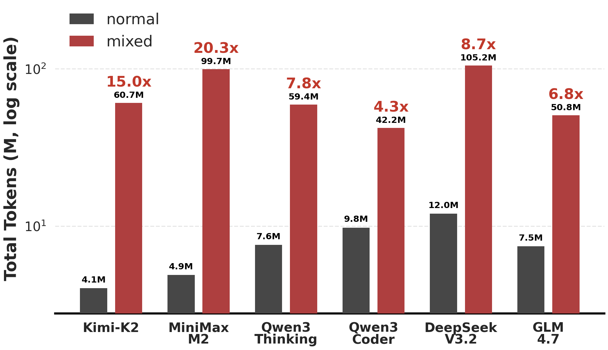

# Overthinking Loops in Tool-Using LLM Agents: Structural Cost Amplification via MCP Tool Registries

Yohan Lee, Jisoo Jang, Seoyeon Choi, Sangyeop Kim, Seungtaek Choi · **Findings of EACL 2027**

Tool-using agents decide which tool to call next from text the tools expose: names, descriptions, and return
messages. We show that this lets a registry steer an agent into **Structural Overthinking**, recurring
tool-call cycles where every call looks reasonable but the trajectory as a whole keeps inflating tokens and
latency.

We build 14 simple cycle-inducing tools on three MCP servers (`tools/`): **repetition**, **iterative
refinement**, and **auxiliary subtasks**. We then compare a `normal` registry (ordinary tools only) with a
`mixed` registry (ordinary tools plus these 14). In Qwen Code on HumanEval, `mixed` increases token usage by
**4.3–20.3×** across six models and cuts accuracy by up to 71 points. ReAct agents on AIME 2025, GPQA Diamond,
and HumanEval show the same pattern. Ordinary tools interleave with the cycle-inducing ones and create
re-entry points into the loop, and lightweight guards do not reliably restore the compute–accuracy trade-off.

<p align="center"></p>

## Usage

```bash
pip install -r requirements.txt
python -m src.download_datasets   # AIME 2025, GPQA Diamond (gated: run `hf auth login`), HumanEval
python -m src.download_toolret    # ordinary tools for ReAct
```

Set an OpenAI-compatible endpoint in `.env` (`OPENAI_BASE_URL`, `OPENAI_API_KEY`, `OPENAI_MODEL_ID`).

```bash
# ReAct: --tool_mode tool (normal) | all (mixed)
python -m src.run_react --dataset_name all --tool_mode all

# Qwen Code on HumanEval (needs the qwen CLI, npx, and Serena in .venv)
MODEL_ID=<model> REGISTRY_MODE=mixed ./scripts/run_qwen_code.sh
```

The cycle-inducing tool servers are released for research only.

## Citation

```bibtex
@inproceedings{lee2027overthinking,
  title     = {Overthinking Loops in Tool-Using {LLM} Agents: Structural Cost Amplification via {MCP} Tool Registries},
  author    = {Lee, Yohan and Jang, Jisoo and Choi, Seoyeon and Kim, Sangyeop and Choi, Seungtaek},
  booktitle = {Findings of the Association for Computational Linguistics: EACL 2027},
  year      = {2027}
}
```

Licensed under [Apache 2.0](LICENSE).
